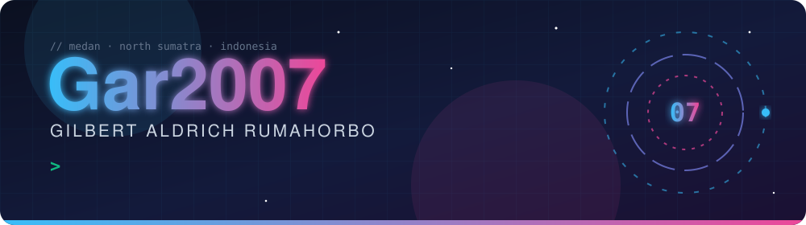
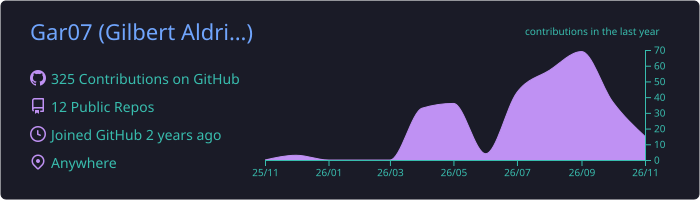
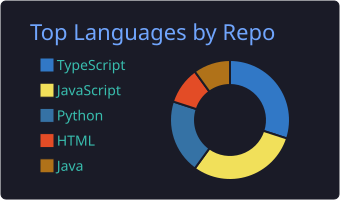
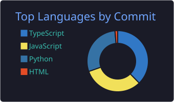
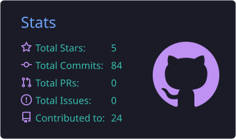
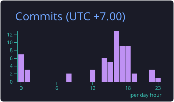

<!-- ═══════════════ HEADER (self-hosted animated SVG) ═══════════════ -->
<div align="center">



<p>
  <a href="https://github.com/Gar07?tab=followers"></a>
  
  
  
</p>

<!-- Quick nav (anchors) -->
<p>
  <a href="#about"></a>
  <a href="#stack"></a>
  <a href="#projects"></a>
  <a href="#stats"></a>
  <a href="#contact"></a>
</p>

</div>

---

<h2 id="about">🧬 About</h2>

```bash
gar2007@kubuntu:~$ cat /etc/gar2007/profile.yaml
```

```yaml
identity:
  name: "Gilbert Aldrich Rumahorbo (Gar)"
  location: "Medan, North Sumatra, Indonesia 🇮🇩"
  education: "B.Sc. Computer Science (S1 Ilmu Komputer) @ Universitas Negeri Medan"

roles:
  - "Student Assistant & IT @ Gugus Penjamin Mutu (GPM) Pascasarjana Universitas Negeri Medan"
  - "Web Development, Pentester & Security Engineer"
  - "Founder @ Axroz Technologies"

focus:
  ai_engineering: [Cognitive Architectures, Computer Vision, Gradient Boosting & Deep Learning, Local LLM Inference]
  cyber_security: [Web & Binary Exploitation, OSINT & Threat Intelligence, Digital Forensics, Automated Recon]
  software_dev:   [Full-Stack Web (TS/React/Vue/Node/Python), Scalable Microservices, 3D WebGL Visualization]

currently:
  building: "Local AI experiments, automated AI Pentester & Companion and AI-assisted LMS"
  learning: "Cognitive architectures, advanced exploitation, DevSecOps"
  ask_me_about: [AI, Cyber Security, CTF, OSINT, Full-Stack]
```

<details>
<summary><b>🚩 Easter egg for fellow hackers (click me)</b></summary>
<br>

Decode this and you get a flag:

```
R0FSe2lfbDB2M19Bdm9jNGQwX2p1MWMzKQ==
```

> Hint: it's not encryption, just encoding. 😉

</details>

---

<h2 id="stack">🛠️ Tech Arsenal</h2>

<div align="center">

**Languages**<br>
&nbsp;
&nbsp;
&nbsp;
&nbsp;
&nbsp;
&nbsp;


<br><br>

**Web, Backend & DevOps**<br>
&nbsp;
&nbsp;
&nbsp;
&nbsp;
&nbsp;
&nbsp;


<br><br>

**AI / ML**<br>
&nbsp;
&nbsp;
<br>


<br><br>

**Environment**<br>
&nbsp;


</div>

<details>
<summary><b>🛡️ Offensive security & pentesting toolkit</b></summary>
<br>

| Domain | Tools & Frameworks |
| :--- | :--- |
| **Web & API Exploitation** | Burp Suite Professional, OWASP ZAP, SQLmap, XSStrike, Dalfox, Invicti |
| **Network & Scanning** | Nmap, Wireshark, Nuclei, Httpx, Subfinder, Masscan |
| **Cracking & Auth Assessment** | Hydra, Hashcat, John the Ripper, Medusa |
| **Exploitation & Recon** | Metasploit Framework, OSINT Framework, Amass, TheHarvester, Maltego |

</details>

<details>
<summary><b>🧠 ML, local LLM & hardware rig</b></summary>
<br>

| Area | Technologies |
| :--- | :--- |
| **Deep Learning & CV** | PyTorch, TensorFlow/Keras, OpenCV, Scikit-Learn |
| **Tabular & Ensembles** | XGBoost, LightGBM, CatBoost, SHAP |
| **Local LLM & Inference** | Ollama, llama.cpp, LiteLLM, vLLM |
| **Prototyping & Math** | Gradio, Streamlit, Pandas, NumPy, Librosa, SageMath |
| **Local rig** | Kubuntu / Kali dual setup, WSL2, Zsh + Polybar, Tailscale mesh, **RTX 5070 local AI rig** |

</details>

---

<h2 id="projects">🚀 Featured Projects</h2>

| Project | What it does | Stack | |
| :--- | :--- | :--- | :---: |
| 🖼️ **[Veripix](https://github.com/Gar07/Veripix)** | Digital image forensics: manipulation, hidden metadata and steganography analysis. |   | [](https://github.com/Gar07/Veripix) |
| 🎰 **[JudolHunter](https://github.com/Gar07/JudolHunter)** | Proactive detection and crawling of illegal online gambling (judol) SEO spam via metadata and DNS analysis. |   | [](https://github.com/Gar07/JudolHunter) |
| 🌐 **[SODA-BIP](https://github.com/Gar07/SODA-BIP)** | 3D WebGL visualization and distributed data portal for large-scale analytical observation. |   | [](https://github.com/Gar07/SODA-BIP) |
| 📐 **[vizin](https://github.com/Gar07/vizin)** | Interactive calculus visualization. |  | [](https://github.com/Gar07/vizin) |
| 🤖 **[DFA-Simulator](https://github.com/Gar07/DFA-Simulator)** | DFA simulator powered by AI. |  | [](https://github.com/Gar07/DFA-Simulator) |
| 🔗 **[CVD](https://github.com/Gar07/CVD)** | [Live demo: cvd.gar2007.me](https://cvd.gar2007.me/) |  | [](https://github.com/Gar07/CVD) |

<details>
<summary><b>🔬 Research & internal systems</b></summary>
<br>

| Project | What it is | Stack |
| :--- | :--- | :--- |
| 🛡️ **HeptaGnosis** | AI-based cognitive architecture framework for cyber-intelligence defense simulation and anomaly-pattern mapping. | `AI Architecture` `PyTorch` `Local LLM` |
| 📊 **SI-SPMI** | Integrated internal quality assurance information system (Sistem Informasi Penjaminan Mutu Internal) for accreditation and quality-standard evaluation in higher education. | `Full-Stack` `PostgreSQL` |

</details>

---

<h2 id="stats">📊 Live Telemetry</h2>

<!-- These cards are generated by .github/workflows/profile-summary-cards.yml and served from this repo,
     so they do not depend on third-party servers. Run the workflow once before they appear. -->

<div align="center">



<br>




<br>




</div>

### 🐍 Contribution Grid Snake

<picture>
  <source media="(prefers-color-scheme: dark)" srcset="https://raw.githubusercontent.com/Gar07/Gar07/output/github-contribution-grid-snake-dark.svg">
  <source media="(prefers-color-scheme: light)" srcset="https://raw.githubusercontent.com/Gar07/Gar07/output/github-contribution-grid-snake.svg">
  
</picture>

---

<h2 id="contact">📡 Let's Connect</h2>

<div align="center">

<a href="https://gar2007.me"></a>
<a href="https://www.linkedin.com/in/gar2007/"></a>
<a href="https://x.com/Gar2007_me"></a>
<a href="https://instagram.com/gar2007.me"></a>
<a href="mailto:gar2007xtech@proton.me"></a>

<br><br>

<sub>💬 Ask me about <b>AI, Cyber Security, CTF, OSINT & full-stack engineering</b> · ⚡ Fun fact: I love the sky</sub>

<br>


</div>
